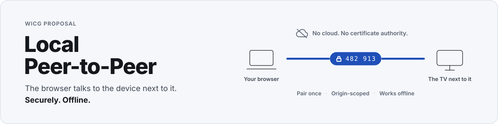

# Local Peer-to-Peer API

<picture>
  <source media="(prefers-color-scheme: dark)" srcset="images/banner-dark.svg">
  
</picture>

[Local Peer-to-Peer](https://WICG.github.io/local-peer-to-peer/) is a Web platform API proposal for secure, offline communication between nearby browsers and devices, without a server.

It has three building blocks.

### Trust between devices

The user pairs two devices once, for example with a PIN or a QR code, and the browser keeps that trust. A site only gets the peers the user grants it; pages never see the network, keys or discovery results.

```js
// Shows the browser's picker; resolves once the user picked a peer and it accepted.
const conn = await new LP2PRequest().start();
```

### Local data pipes

Data channels, aligned with `RTCDataChannel`. This API isn't fully specified yet and depends on LP2P issue 29.

```js
const channel = conn.createDataChannel("chat");
channel.onopen = () => channel.send("Hi you!");
```

WebTransport, aligned with the `WebTransport` API.

```js
const transport = await lp2p.connect({ ...options });
```

### Local HTTPS (separate draft)

[Local HTTPS](https://WICG.github.io/local-peer-to-peer/local-https.html) lets the browser talk securely to HTTPS servers on the local network without public certificate authorities, using the same trust. The browser is a client, not a server.

For a more in-depth overview, see the [Explainer](EXPLAINER.md).

## Status

This specification is a work in progress.

## Links

- [Explainer](EXPLAINER.md)
- [Specification](https://WICG.github.io/local-peer-to-peer/)
- [Local HTTPS](https://WICG.github.io/local-peer-to-peer/local-https.html) (separate draft)
- [One-Pager](./images/onepager.svg) ([PDF](./images/Local%20Peer-to-Peer%20API%20-%20One-Pager.pdf))

## Feedback

We welcome feedback via the [issue tracker](https://github.com/WICG/local-peer-to-peer/issues) of this GitHub repo. [Contributions](CONTRIBUTING.md) are welcome via pull requests too.
